# CompactionAnalyzer

Cells apply contractile forces to their surroundings, for example during migration, development, wound healing, or disease. To study these processes, cellular forces can be measured using traction force microscopy. However, 3D traction force microscopy can be laborious, requiring nonlinear finite-element models, rheology and regularization. In 3D fiber networks, alignment and compaction of fibers are consequences of cellular forces. CompactionAnalyzer quantifies fiber alignment and changes in fiber image intensity around cells in fiber matrices. These quantities can be used as indirect measures of cell contractility and to resolve drug-induced changes in the surrounding matrix.

<p align="center">
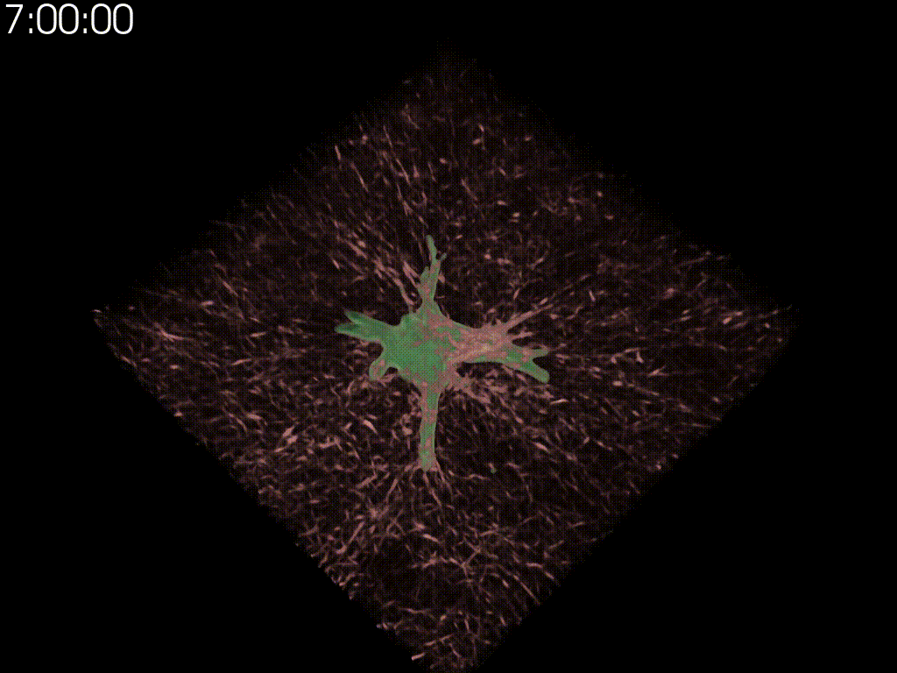
</p>
<p align="center">
Hepatic stellate cell compacting a collagen type I hydrogel over time.
</p>


### Choose the reference for your image

CompactionAnalyzer analyzes the orientation of fibers and other structures in images. Depending on the analysis mode, orientation is measured relative to **a cell center obtained from a cell mask**, **the X or Y axis**, **a selected point**, or **a line**. Cell-relative alignment in a fiber network is the main method and serves as a marker of contractility. The other references extend the analysis to applications such as actin alignment within cells or fiber alignment along a tissue axis.

| [Cell Relative Alignment](#alignment-around-contractile-cells) | [General Alignment Analysis](#additional-orientation-modes) | [Relative to a point or line](#additional-orientation-modes) |
|:---:|:---:|:---:|
| 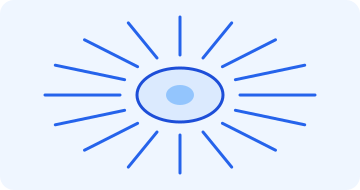 | 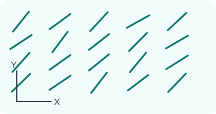 |  |
| **Main method: a marker of contractility.**<br>Fiber alignment towards a cell and matrix compaction around it. | Alignment relative to the X and Y axes.<br>**Whole image**, or an optional mask to select the analysis area. | Choose **one point** for radial alignment or **two points** for alignment along a line. |

Start with the **[examples](#examples-in-pictures)**, the **[Orientation interface in Saenopy](#graphical-user-interface-gui)**, or the **[Python API](#api-analyze-an-image-with-a-single-call)**.

Or simply **[Try it online →](https://davidbhr.github.io/CompactionAnalyzer/)** ([https://davidbhr.github.io/CompactionAnalyzer/](https://davidbhr.github.io/CompactionAnalyzer/)): Analyze fiber orientation in your browser. Load an example or your own data and compare measurements without installation.


## Alignment around contractile cells

The main method quantifies tissue compaction around cells or multicellular spheroids embedded in fibrous materials, as a measure of their contractile activity.

<details>
<summary><strong>How it works: cell-relative alignment and compaction</strong></summary>

For this, we provide two approaches:

* Evaluating the directionality of fibers towards the cell center.
* Evaluating the increased fiber image intensity around the cell.

The cell image supplies the segmentation and the cell center. The fiber image supplies the local directions, calculated by structure tensor analysis. We then evaluate how strongly fibers align towards the cell center and how alignment and image intensity change with distance from the cell surface. These structural changes serve as markers of cell contractility; they do not directly return a force value.

The analysis uses **2D images**, such as individual optical sections or maximum-intensity projections of a 3D matrix. The measured orientations lie in the image plane; the package does not reconstruct a 3D orientation field. **Cell-relative analysis is the default in the batch pipeline (`StuctureAnalysisMain`).**

<a href="docs/images/Fig1-rawtostructure.png">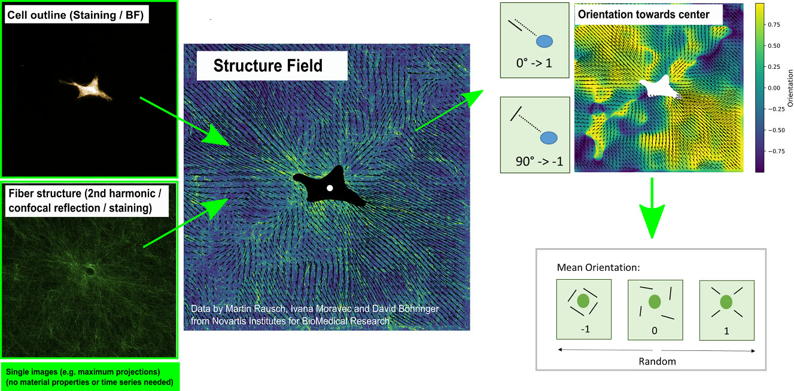</a>

</details>

## Additional orientation modes

Measure fiber orientation relative to the X/Y axes, a selected point or a line, across the whole image or within a mask.

<details>
<summary><strong>How it works: X/Y axes, masks, point and line references</strong></summary>

### Measurement options and interpretation of the outputs

| Measurement | Images needed | What it measures |
|---|---|---|
| **Cell-relative alignment — main method** | A fiber image and a cell image | Alignment towards the cell center and changes in alignment and image intensity with distance from the cell; markers of contractility |
| **Whole image** | One orientation image | Orientation and alignment to the X or Y axis across the image |
| **Mask from the same image** | One orientation image, also used to create the mask | Orientation within the selected area, for example actin alignment within a phalloidin-stained cell |
| **Mask from a second image** | An orientation image and a registered mask image | Orientation within independently selected regions; for example, an α-actinin stain can select cardiomyocyte regions in a culture containing cardiomyocytes and fibroblasts |
| **Relative to a point** | One orientation image and a selected point | Radial alignment towards a chosen reference, using the same geometry as the cell-center calculation |
| **Relative to a line** | One orientation image and two selected points | Alignment parallel to a fixed reference line across the image |

For the three X/Y measurements, the **orientation image** supplies the local directions. A **mask image** only selects the area included in the analysis; it does not define a radial reference. When using the same image for both purposes, blur and threshold select the area while orientation is calculated from the original image. Inspect the mask before analysis: an intensity threshold selects stained regions and does not automatically separate individual cells or identify cell types.

**Coherency** describes the strength of local alignment independently of the reference direction. It is available in every mode. Regions can have high local coherency while pointing in different directions across the image, as in multiple cells with differently oriented stress fibers.

| Output | Interpretation |
|---|---|
| **Cell-relative alignment** | +1 radial towards the cell center, 0 at 45°, and −1 tangential |
| **Angle to X or Y** | Signed local angle in degrees in `[-90, 90)`; directions differing by 180° are equivalent |
| **Alignment to X or Y** | +1 parallel, 0 at 45°, and −1 perpendicular; calculated as `1 - abs(angle) / 45` |
| **Angular deviation** | Unsigned angle to the reference direction, from 0° parallel to 90° perpendicular |
| **Coherency** | Local directional consistency, from 0 isotropic to 1 strongly directional within the tensor window |

### Point and line references

Use a **point** when the direction should vary across the image, as in fibers pointing towards a chosen center. Use a **line** when one direction should apply everywhere, for example the long axis of a tissue, a channel or an imposed stretch direction. Both work with one orientation image. An optional mask, from the same image or a second channel, selects the area to analyze without changing the reference.

### How to choose a point or line in Saenopy

In Saenopy, choose **Relative to a Point or Line**, then **Point** or **Line** when adding the measurement. One click sets the point; two distinct clicks define the line. A line acts as an axis extending across the whole image: its position and length do not select an area, and reversing its endpoints does not change the result. Alignment is +1 parallel and −1 perpendicular to the line. See the [GUI walkthrough](#graphical-user-interface-gui) or the [Python API](#api-analyze-an-image-with-a-single-call).

</details>

## Installation & Graphical User Interface

**Option A (for Python users):** install the published package in your Python environment:

```bash
python -m pip install CompactionAnalyzer
```

<details>
<summary>Install the example scripts or the Saenopy GUI with pip</summary>

To use the example images and scripts, clone this repository and install it
from the repository root:

```bash
python -m pip install -e .
```

**Graphical interface:** install [Saenopy](https://github.com/rgerum/saenopy),
which includes CompactionAnalyzer as a dependency:

```bash
python -m pip install --upgrade saenopy
saenopy
```

</details>

Standalone applications are available on the [Saenopy releases page](https://github.com/rgerum/saenopy/releases).
In the **Orientation** interface, choose **Relative to Cell**, **Relative to X and Y Axes**,
or **Relative to a Point or Line**. X/Y analysis supports the whole image,
a mask from the same image, or a mask from a second image.
See the [GUI walkthrough below](#graphical-user-interface-gui) for examples.

## Graphical User Interface (GUI)

CompactionAnalyzer is included in [Saenopy](https://github.com/rgerum/saenopy). Select the **Orientation** tab, then choose cell-relative analysis, X/Y orientation, or a point/line reference. Load individual images or use `*` to load a batch.

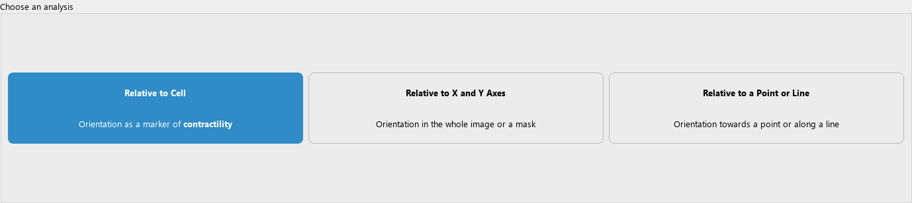

<details>
<summary>Load images, check the mask and compare results</summary>

For cell-relative analysis, select a fiber image and a cell image. For X/Y analysis, select an orientation image and choose **Whole image**, **Mask from the same image**, or **Mask from a second image** when adding the measurement.

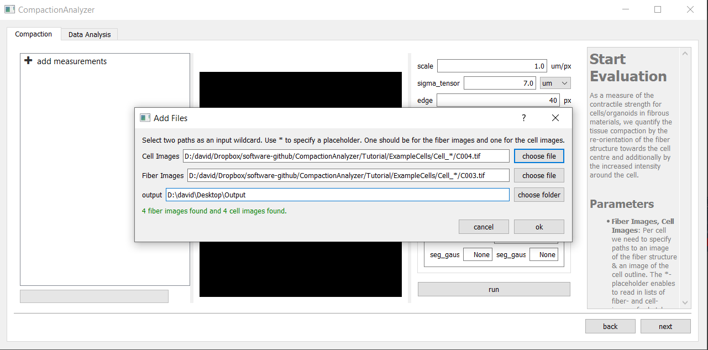

Set the pixel size and analysis parameters. Adjust the segmentation or mask threshold and inspect the red overlay, then run **find orientations** or **run all**.

<a href="docs/images/GUI_evaluation.png">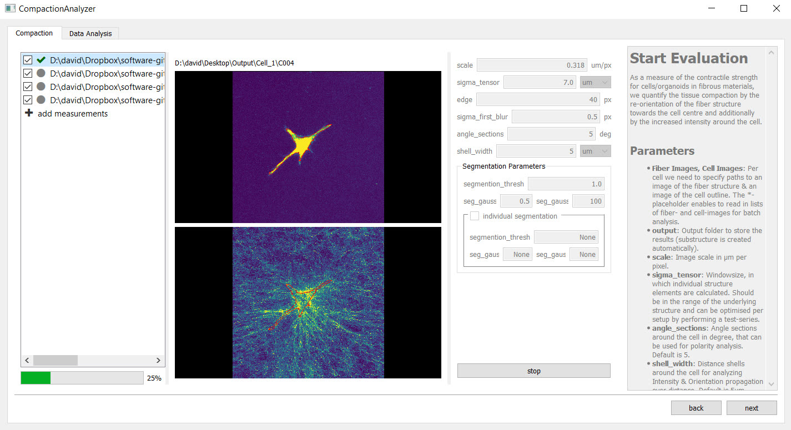</a>

The **Angle** tab switches between X and Y. **Coherency** shows the local strength of alignment. Cell measurements also show orientation towards the cell center; X/Y measurements show **Axis alignment**. Each measurement displays the tabs for its selected mode.

In **Data Analysis**, compare individual measurements or combine them into groups. Available quantities include alignment, angular deviation, coherency and angle histograms. Cell measurements also provide intensity and distance plots. Quantities unavailable for the selected measurements are greyed out. Group plots show means and standard errors; each image has equal weight. Histogram probabilities sum to 1 per image. **Export** saves the plotting code and data.

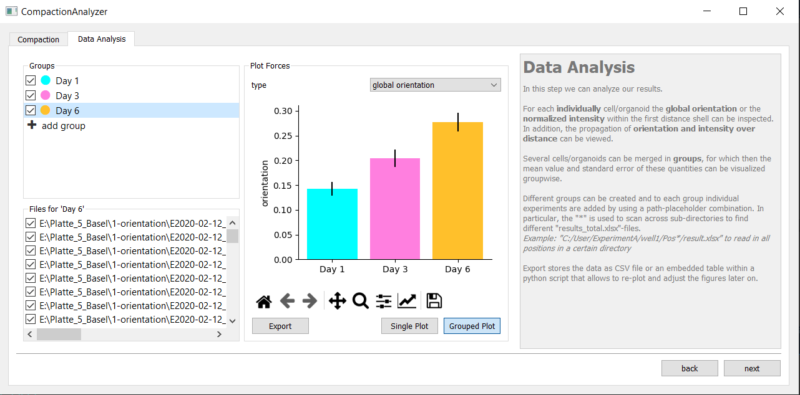

The GUI saves **`.saenopyOrientation`** files. Drag them into the measurement view to inspect results or into **Data Analysis** to compare groups. Keep the input images with the result files. The three viewer screenshots above show the original cell workflow.

</details>

<details>
<summary>Point and line selection: GUI steps and screenshots</summary>

For **Point**, use **Choose reference point** and click the image. For **Line**, use **Choose reference line** and click two distinct points. Run **find orientations** after setting or changing the reference. In line mode, **Angle** and **Alignment (line)** switch between **Line / X / Y**. Alignment is +1 parallel and −1 perpendicular to the line.

<a href="docs/images/GUI_reference_line.png">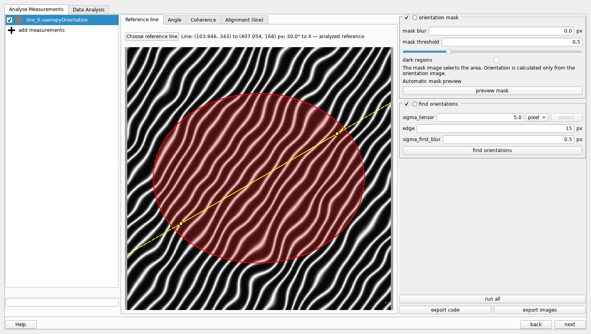</a>

The reference and mask are saved with each measurement. **Data Analysis** also provides line-relative alignment, angular deviation and an angle histogram. The example below combines three synthetic fiber images with a preferred 25° deviation from the reference line and varying local directions.

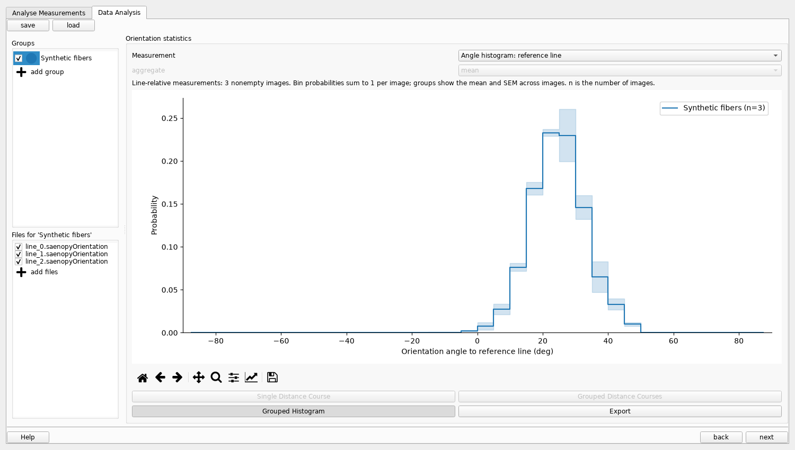

</details>

To call the analysis from another program, see the [Python API below](#api-analyze-an-image-with-a-single-call). The GUI's **Help** panel also includes a Python call for the selected mode.


You can also **compare experimental conditions**: collect multiple images per
condition and compare their mean alignment, angular deviation or coherency in
**Data Analysis**, or use Python without the GUI.
[See the comparison example below.](#compare-conditions)

### Examples by analysis mode

For X/Y, point and line analyses, choose the whole image or a mask from the same or a second image.
You can also load examples in **Saenopy → Orientation → Add Measurements → Examples**.
The links lead to pictures, runnable scripts and short API calls. Each mode has
a main example below; expand the named alternatives to see the other cases.

| Analysis mode | Examples | Python script | API call | Saenopy |
|---|---|---|---|---|
| 🔵 **Cell-relative orientation**<br>Marker of contractility | [Cell in collagen](#-cell-relative-orientation--marker-of-contractility) | [Cell example](Tutorial/Example_Quickstart.py) | [Cell alignment](#cell-relative-alignment-collagen) | [Open in GUI](https://github.com/rgerum/saenopy#fiber-orientation) |
| 🟢 **Orientation to X/Y axes** | [α-Actinin mask](#mask-from-a-second-image)<br>[Whole collagen image](#whole-image)<br>[Stress fibers in the cell area](#mask-from-the-same-image) | [Cardiomyocytes](Tutorial/Example_BiologicalOrientation.py)<br>[Collagen / stress fibers](Tutorial/Example_GeneralOrientation.py) | [Second-image mask](#mask-from-a-second-image)<br>[Whole image](#whole-image-orientation)<br>[Same-image mask](#orientation-inside-a-mask) | [Open in GUI](https://github.com/rgerum/saenopy#fiber-orientation) |
| 🟣 **Orientation towards a point** | [Spheroid center](#spheroid-center)<br>[Point in a cell](#lamellipodia-around-a-cell-point)<br>[Synthetic fiber field](#synthetic-fiber-field-around-a-point) | [Spheroid / cell](Tutorial/Example_BiologicalOrientation.py)<br>[Synthetic field](Tutorial/Example_SyntheticReferences.py) | [Spheroid](#spheroid-center)<br>[Cell](#lamellipodia-around-a-cell-point)<br>[Synthetic point](#orientation-towards-a-point) | [Open / create results](#biological-examples-in-saenopy) |
| 🟣 **Orientation relative to a line** | [Cardiomyocytes](#cardiomyocytes-aligned-along-a-line)<br>[Synthetic fibers](#synthetic-fibers) | [Cardiomyocytes](Tutorial/Example_CardiomyocyteLine.py)<br>[Synthetic fibers](Tutorial/Example_SyntheticReferences.py) | [Cell image](#cardiomyocytes-aligned-along-a-line)<br>[Synthetic line](#orientation-relative-to-a-line) | [Open / create results](#biological-examples-in-saenopy) |

### Examples in pictures

Each example below shows one analysis case, with a runnable script and a
link to its Python API call. Run the commands from the repository root.

#### 🔵 Cell-relative orientation — marker of contractility

Collagen alignment towards the center of a calcein-stained cell.
The cell image supplies the segmentation and the reference center.

[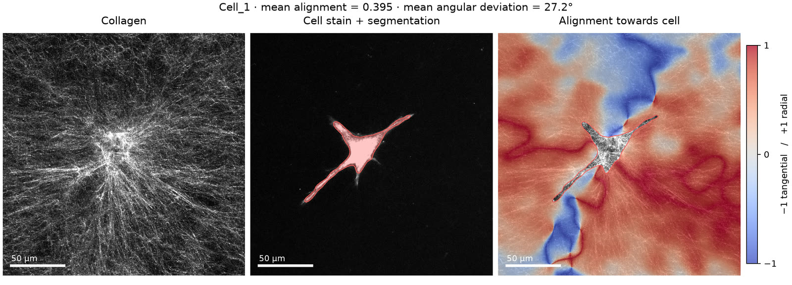](docs/images/collagen-api-quickstart.png)

*Left: collagen. Middle: cell stain and segmentation. Right: alignment towards
the cell center, from −1 tangential to +1 radial.*

[Example script](Tutorial/Example_Quickstart.py) · [Python API call](#cell-relative-alignment-collagen)

```bash
python Tutorial/Example_Quickstart.py --case cell --figure cell.png
```

#### 🟢 Orientation relative to X/Y axes

##### Mask from a second image

Phalloidin labels actin fibers in both cardiomyocytes and fibroblasts. To
distinguish cardiomyocyte regions from fibroblasts, the α-actinin channel defines
a mask. The **mask from a second image** mode then measures the orientation of
phalloidin-labeled actin within this mask, relative to the X and Y axes.
α-Actinin supplies the cell region; phalloidin supplies the orientation signal.

[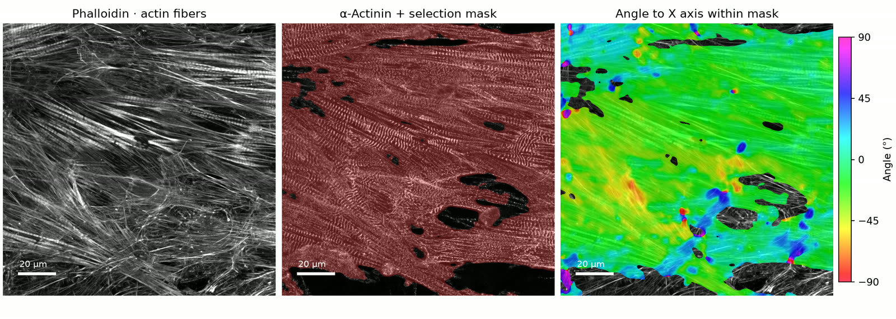](docs/images/example-cardiomyocyte.png)

*Left: phalloidin. Middle: α-actinin with the selected area in red. Right: phalloidin
orientation within the mask. Scale bars: 20 µm; TIFF calibration: 0.156 µm/pixel.*

[Example script](Tutorial/Example_BiologicalOrientation.py) · `--case cardiomyocyte`

```python
from CompactionAnalyzer import analyze_image

cardiomyocyte = analyze_image(
    "Tutorial/BiologicalExamples/cardiomyocyte_05/phalloidin.tif",
    mask_image="Tutorial/BiologicalExamples/cardiomyocyte_05/actinin.tif",
    mode="axis_orientation_masked", sigma_tensor=8, edge=15,
    mask_sigma=8, mask_threshold=0.65,
    outputs=["angle_x", "mean_deviation_x", "coherency"],
)
```

<details>
<summary>Cell-free collagen — whole-image orientation</summary>

##### Whole image

A cell-free collagen network is compared with isotropic, spatially correlated
Gaussian noise. The noise is generated by smoothing independent Gaussian pixels
equally in all directions (Gaussian sigma 3 pixels), without imposing a preferred
direction. Both images then use the same analysis: tensor sigma 28.1 pixels,
initial blur 0.5 pixels and a 128-pixel edge crop.

Uniformly distributed orientations give a mean alignment of 0 and a mean absolute
angular deviation of 45°. Here, alignment to X is −0.080 for collagen and −0.017
for noise; the corresponding deviations are 48.6° and 45.8°. The noise histogram
is approximately uniform, whereas collagen has a broad, asymmetric distribution.
Coherency is 0.162 for collagen and 0.068 for noise. A near-zero alignment alone
does not establish isotropy or identify a unique preferred angle.

Uncorrelated pixel noise can produce artificial diagonal peaks with the
finite-difference gradients at this initial blur. A larger edge crop alone does
not remove them. The control shown here instead has spatial structure over
several pixels; it is not a white-pixel-noise control.

[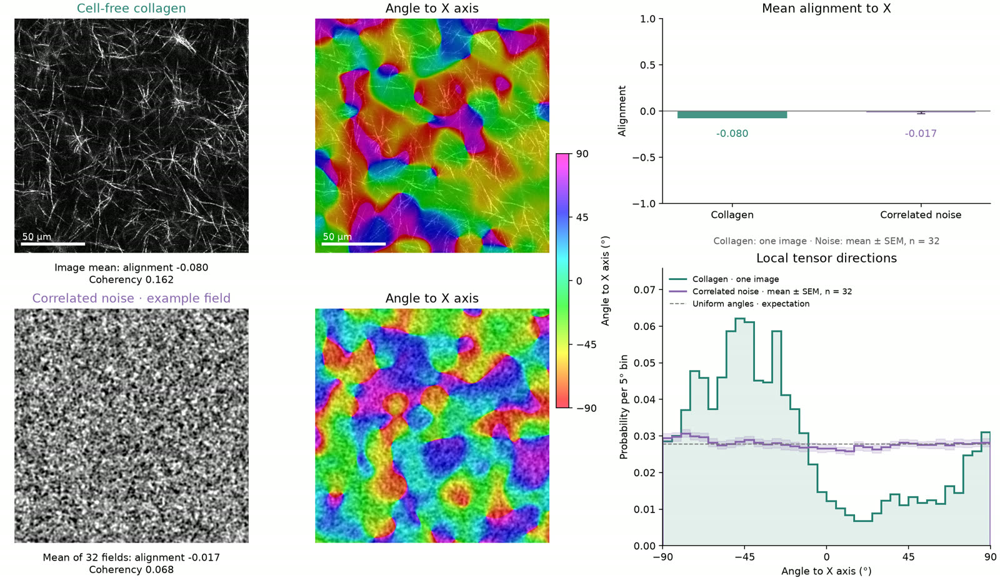](docs/images/example-whole-image.png)

*Top: collagen and its angle map; scale bars: 50 µm. Bottom: one of 32
independent, spatially correlated noise fields and its angle map. Right: the bars
compare mean X alignment on a −1 to +1 scale; both means are close to zero despite
the different angle distributions below. Collagen is green; noise is purple
(mean ± SEM over the 32 fields). The dashed line marks uniformly distributed angles.
Histograms count local tensor directions in 5° bins, not individual
fibers. Each image's histogram sums to 1 before averaging; both curves sum to 1.*

[Example script](Tutorial/Example_GeneralOrientation.py) · [Python API call](#whole-image-orientation)

```bash
python Tutorial/Example_GeneralOrientation.py --case whole --figure whole.png
```

</details>

<details>
<summary>Stress fibers within the cell area — mask from the same image</summary>

##### Mask from the same image

Phalloidin labels filamentous actin, making stress fibers visible within cells.
This example can be used to examine how treatments affect stress-fiber
organization. The angle map shows the orientation of these fibers, while
coherency measures the strength of their local alignment, independently of
the preferred direction. High coherency indicates a clear local orientation;
low coherency indicates little directional order.

To measure stress-fiber orientation within cells, use the phalloidin image both
for the orientation analysis and to select the stained cell area. The mask
excludes the surrounding background from the maps and averages. It selects
stained regions rather than segmenting individual cells.

[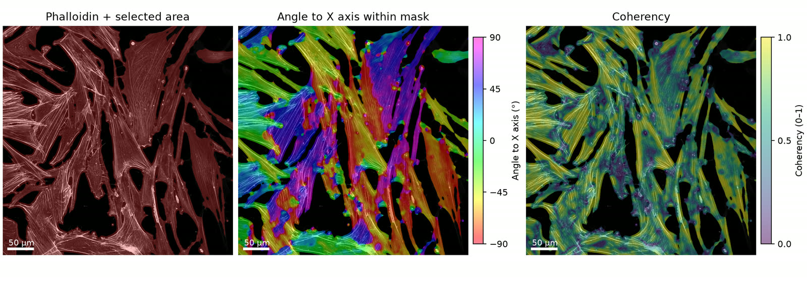](docs/images/example-same-image-mask.png)

*Left: selected cell area in red. Middle: angle to X within this area. Right:
coherency, from 0 (isotropic) to 1 (strongly directional), independent of the
reference direction. Both maps overlay the phalloidin image at 50% opacity,
keeping the cell structures visible. Scale bars: 50 µm.*

[Example script](Tutorial/Example_GeneralOrientation.py) · [Python API call](#orientation-inside-a-mask)

```bash
python Tutorial/Example_GeneralOrientation.py --case mask --figure mask.png
```

</details>

#### 🟣 Orientation towards a point

Click a point in the image and measure local orientation relative to the radial
direction towards it. Use the spheroid center, a point in a cell, or the center
of a synthetic fiber field. An optional mask selects the analyzed area independently
of the point.

##### Spheroid center

Place the reference point in the center of the spheroid to measure
the orientation of surrounding cell structures towards it. A peripheral mask
excludes the spheroid core, background and the annotation in the supplied image.

[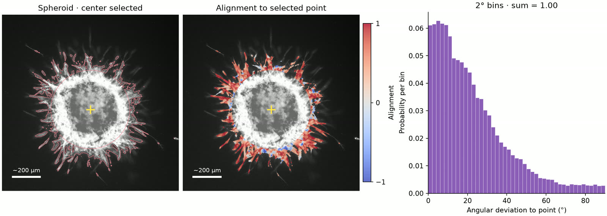](docs/images/example-spheroid.png)

*Yellow cross: selected point. Pink outline: analyzed region. Alignment is +1
radial and −1 tangential. Each histogram bin contains a fraction of the selected
pixels, and all bins sum to 1. The display is enlarged; point coordinates refer
to the full input image.*

```python
import imageio.v2 as imageio
from CompactionAnalyzer import analyze_image

spheroid = analyze_image(
    "Tutorial/BiologicalExamples/spheroid/orientation.tif",
    mode="point_orientation", reference_point=(1200, 910),
    mask=imageio.imread("Tutorial/BiologicalExamples/spheroid/selection.tif") > 0,
    sigma_tensor=6, edge=15,
    outputs=["alignment_point", "mean_angle_point"],
)
```

<details>
<summary>Lamellipodia — click a point in the cell</summary>

##### Lamellipodia around a cell point

Place a point in the mouse fibroblast and measure the orientation of its cell
membrane relative to that point. The mask selects the lamellipodial region and
excludes the central nuclear region and the other cells.

[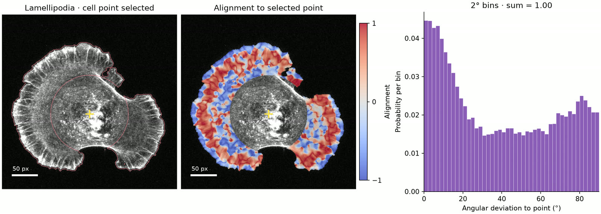](docs/images/example-lamellipodia.png)

```python
import imageio.v2 as imageio
from CompactionAnalyzer import analyze_image

lamellipodia = analyze_image(
    "Tutorial/BiologicalExamples/lamellipodia/orientation.tif",
    mode="point_orientation", reference_point=(390, 325),
    mask=imageio.imread("Tutorial/BiologicalExamples/lamellipodia/selection.tif") > 0,
    sigma_tensor=3, edge=15, shell_width=10,
    outputs=["alignment_point", "mean_angle_point", "distance_profile"],
)
```

###### Distance shells around a point

Average the orientation in concentric rings to see how it changes with distance
from the selected point. The same mask selects the lamellipodial area within
each ring. Here, the ring width is 10 pixels; distances are shown in pixels
because this image has no known physical calibration.

[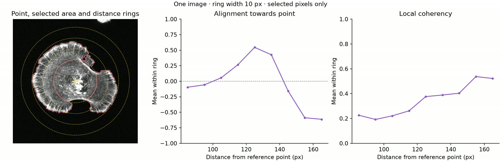](docs/images/example-lamellipodia-distance.png)

*One image: each point on a curve is the mean of the selected pixels in that
ring. Empty rings have no value. Alignment is +1 radial and −1 tangential;
coherency describes local directional consistency. The dashed guide rings in
the image are 40 pixels apart; the calculation uses 10-pixel rings.*

The API call above returns the profile together with the image results:

```python
import matplotlib.pyplot as plt

profile = lamellipodia["distance_profile"]
plt.plot(profile["distance_px"], profile["mean_alignment_point"], "o-")
plt.xlabel("Distance from reference point (px)")
plt.ylabel("Alignment towards point")
plt.ylim(-1, 1)
plt.show()
```

The profile also contains `mean_angle_point`, `mean_coherency`, and pixel
counts for each ring. With a measured `scale` in µm/pixel, `distance_um` gives
the corresponding physical distances. The same analysis is available for
the spheroid and other point references.

In **Saenopy**, set **shell_width**, run **find orientations**, then select
**Point alignment over distance**, **Angular deviation to point over distance**,
or **Coherency over distance from point** in **Data Analysis**. Choose a single
measurement or grouped courses and display distances in pixels or µm. Groups
average one value per image in each ring, with SEM across images; matching
ring widths are required. Older point results can use their saved maps without
repeating the image analysis.

[Example script](Tutorial/Example_BiologicalOrientation.py):

```bash
python Tutorial/Example_BiologicalOrientation.py --case lamellipodia --shell-width 10 --distance-figure distance.png
```

</details>

<details>
<summary>Synthetic fiber field around a point</summary>

<a id="synthetic-nematic-defect"></a>

##### Synthetic fiber field around a point

A synthetic fiber field winds around a central reference point. The fibers
have a preferred deviation of 25° from the radial
direction, with smooth random bending and added intensity noise. An annular mask
excludes the unresolved center and image margins.

[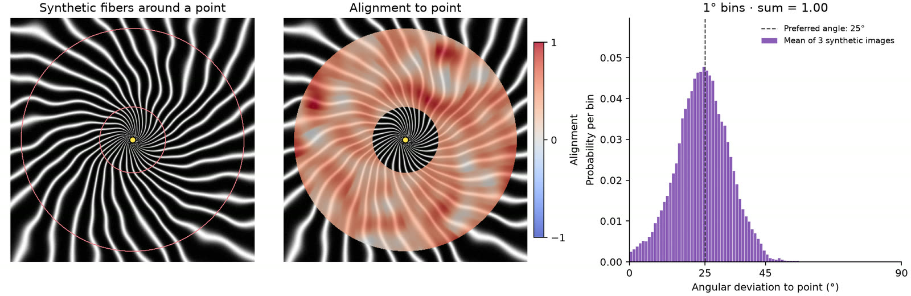](docs/images/example-point-reference.png)

*Left: the reference point in yellow and mask boundary in pink. Middle: alignment
within the mask. Right: mean histogram from three synthetic images in 1° bins. The bin
probabilities sum to 1 in each image and in the mean histogram. Local directions vary around the preferred angle,
producing a roughly bell-shaped distribution. The measured mean deviation is
about 24.2°.*

[Example script](Tutorial/Example_SyntheticReferences.py) · [Python API call](#orientation-towards-a-point)

```bash
python Tutorial/Example_SyntheticReferences.py --case point --output synthetic_examples
```

</details>

#### 🟣 Orientation relative to a line

Click two points to define a reference direction. The line extends across the
image; its length does not restrict the analyzed region. A mask can select the
regions to include.

<a id="rotated-cardiomyocytes"></a>

##### Cardiomyocytes aligned along a line

When the alignment direction is not parallel to the X or Y axis, click two
points along it to define a reference line. Here, the line follows the main longitudinal direction of
phalloidin-stained cardiomyocytes. Orientation is measured throughout the image
relative to this line, without a mask.

[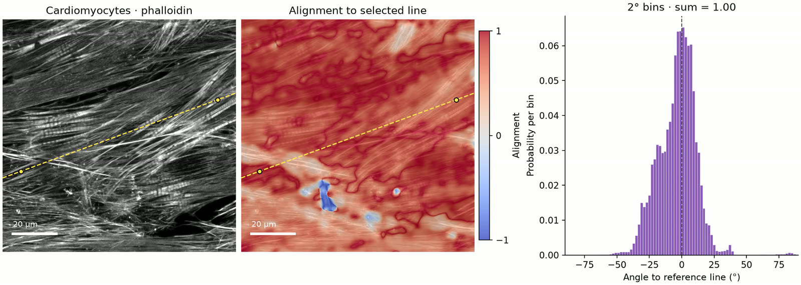](docs/images/example-cardiomyocyte-line.png)

*Yellow points define the reference line along the cells. Alignment is +1
parallel and −1 perpendicular to the line. Here, mean alignment is
0.746 and mean absolute deviation is 11.4°. Histogram probabilities sum to 1.
Scale bars: 20 µm.*

[Example script](Tutorial/Example_CardiomyocyteLine.py)

```python
from CompactionAnalyzer import analyze_image

line = analyze_image(
    "Tutorial/BiologicalExamples/cardiomyocyte_line/orientation.tif",
    mode="line_orientation", reference_line=((69, 469), (655, 255)),
    sigma_tensor=8, edge=15,
    outputs=["alignment_line", "mean_alignment_line", "mean_deviation_line"],
)
```

In Saenopy, open **Orientation relative to a line — cardiomyocytes**. Use
**Choose reference line** and click two points to change the line, then run
**find orientations**. **Angle** and **Alignment** can switch between Line, X and Y.

<details>
<summary>Synthetic fibers — a known 25° deviation from the selected line</summary>

##### Synthetic fibers

Synthetic fibers have a preferred direction of 55° to X. Smooth random bending
adds local variation, and intensity noise adds image grain. The selected line
lies at 30°, giving a preferred deviation of 25°. An elliptical mask selects
the analyzed area.

[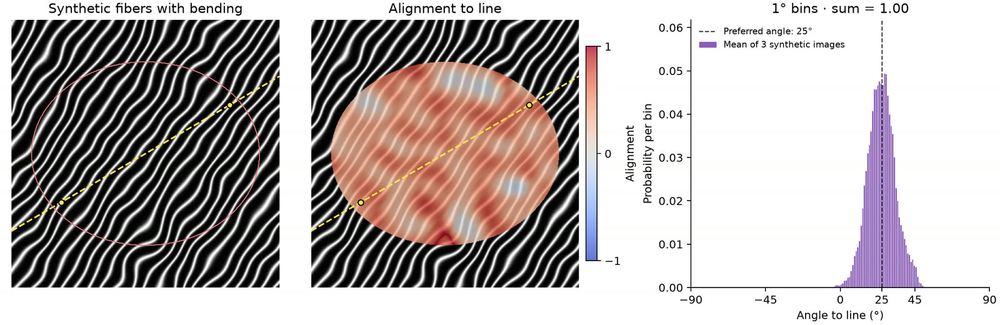](docs/images/example-line-reference.png)

*Left: the reference line in yellow and mask boundary in pink. Middle: alignment
within the mask. Right: mean histogram from three synthetic images in 1° bins. The bin
probabilities sum to 1 in each image and in the mean histogram. The distribution shows the variation in local angles.
The measured mean deviation is about 24.8°.*

[Example script](Tutorial/Example_SyntheticReferences.py) · [Python API call](#orientation-relative-to-a-line)

```bash
python Tutorial/Example_SyntheticReferences.py --case line --output synthetic_examples
```

</details>

<details>
<summary>Open these examples in Saenopy or create portable results</summary>

#### Biological examples in Saenopy

The prepared **α-actinin mask**, **spheroid point** and **cardiomyocyte line** examples include images,
masks and evaluated `.saenopyOrientation` files. In **Add Measurements → Examples**,
choose **Open (evaluated)** to inspect them or **Open** to rerun the analysis.
You can also generate portable results locally:

```bash
python Tutorial/Example_BiologicalOrientation.py --case cardiomyocyte --saenopy biological_results
python Tutorial/Example_BiologicalOrientation.py --case spheroid --saenopy biological_results
python Tutorial/Example_CardiomyocyteLine.py --saenopy biological_results
```

Drag the result files into Saenopy and keep their image folders together.
For the uncalibrated MAX image, use the pixel-based API example above; GUI export
requires its measured pixel size through `--pixel-size`.

#### Synthetic examples in Saenopy

With Saenopy installed, add `--saenopy` to create three evaluated
`.saenopyOrientation` files per case, together with their images and masks:

```bash
python Tutorial/Example_SyntheticReferences.py --output synthetic_examples --saenopy
```

Drag the result files into **Analyse Measurements** or **Data Analysis**.
The references and masks are already saved; you can change them and rerun the
analysis. Keep each result with its image and mask. These are synthetic
geometry examples, not measurements of cells. The existing collagen examples
remain available in the GUI and in [the point](Tutorial/Example_PointOrientation.py)
and [line](Tutorial/Example_LineOrientation.py) scripts.

</details>

## Compare conditions

Compare several images per condition to assess differences in cell-relative
alignment, alignment to the image axes or a selected point/line, or local
coherency. This can be used, for example, to compare stress-fiber organization
between perturbations. Use the same analysis settings and comparable image
regions across conditions.

First calculate a value for each image, then average these image values within
each condition. **Each image has equal weight.** Group plots show the mean and
standard error of the mean (SEM); **n is the number of images**. When several
images belong to one biological replicate, first combine them per replicate
if the comparison should give equal weight to biological replicates.

The example below uses three **synthetic conditions**, with three independently
generated images each: horizontal fibers, fibers crossing in many directions,
and vertical fibers. All use the same horizontal reference line, selected area
and analysis settings. Horizontal fibers have positive alignment and vertical
fibers have negative alignment; the crossing network has a mean closer to zero.
Both aligned networks have high local coherency, regardless of their direction.
Crossings reduce local coherency because several directions occur within the
same analysis window.

<a href="docs/images/Example_condition_comparison.png">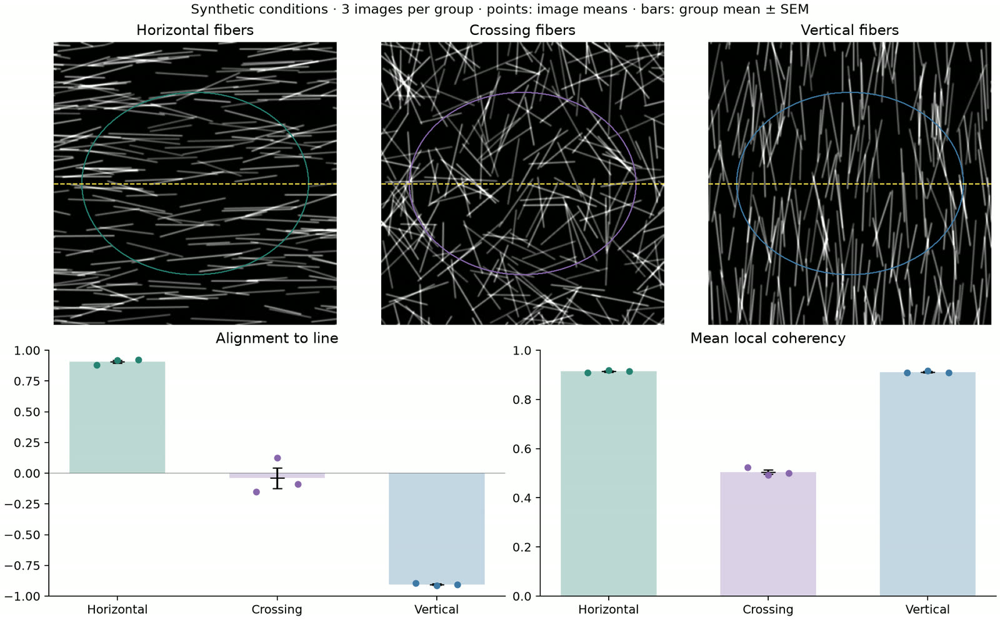</a>

*Each dot represents one image. Bars show the group mean ± SEM. The dashed line
is the orientation reference; the outline marks the analyzed area. These are
demonstration data, not measurements of a biological perturbation.*

<details>
<summary>Compare groups in Saenopy: steps and example</summary>

In **Data Analysis**, create a group for each condition with **add group**,
rename it, and add the corresponding `.saenopyOrientation` files. Select a
quantity such as **Alignment to reference line** or **Coherency**, then use
**Grouped Bar Plot**. Each available metric uses the same grouping.

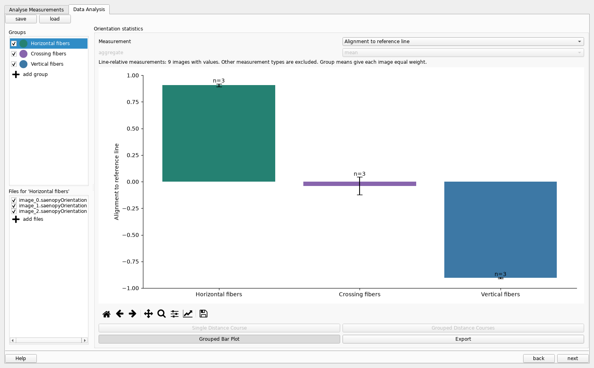

Angle histograms can also be compared between groups. Each image's histogram
is normalized to a total probability of 1 before averaging across images;
the group histogram therefore also sums to 1. **Export** saves the plotting
code and data.

To generate the nine example measurements, run this from the repository root
with Saenopy installed:

```bash
python Tutorial/Example_CompareConditions.py --output comparison_output --saenopy
```

Add the files from `comparison_output/horizontal_fibers`,
`comparison_output/crossing_fibers` and `comparison_output/vertical_fibers`
to three separate groups. Keep the images and masks beside their result files. The synthetic images use one coordinate unit per pixel;
they have no biological length calibration.

</details>

<details>
<summary>Compare groups from Python: runnable example and image-level results</summary>

[Example_CompareConditions.py](Tutorial/Example_CompareConditions.py) generates
the images, calls the [Python API](#api-analyze-an-image-with-a-single-call)
once per image, and groups the returned values. It runs without Saenopy:

```bash
python Tutorial/Example_CompareConditions.py --output comparison_output
```

You can also run it from Python in the repository root:

```python
from Tutorial.Example_CompareConditions import run

per_image, groups = run("comparison_output")
print(per_image[["condition", "mean_alignment_line", "mean_coherency"]])
print(groups["mean_coherency"])  # mean, SEM and image count for each condition
```

The script saves `per_image.csv`, `group_summary.csv` and `comparison.png`.
For your own data, replace the synthetic image generator with your image paths
and choose the API mode and outputs needed for your comparison. The grouping
step stays the same:

```python
summary = per_image.groupby("condition")["mean_coherency"].agg(
    ["mean", "sem", "count"]
)
```

Here, coherency is averaged over the selected pixels in each image. For other
quantities, use the corresponding image means. Average absolute angular
deviations or alignment values rather than signed angles, whose wrap at ±90°
can give misleading arithmetic means. An empty selection gives a missing
value and is excluded from the count for that metric; SEM needs at least two
images. The classic cell workflow also provides
[combined Excel results](#usage-from-python).

</details>

## Usage from Python

Use a script to analyze images and save figures, NumPy maps and Excel tables.
This minimal example analyzes one bundled collagen/cell pair and saves the
results in `cell_results`. Run it from the repository root:

```python
from CompactionAnalyzer.CompactionFunctions import StuctureAnalysisMain

StuctureAnalysisMain(
    fiber_list=["Tutorial/ExampleCells/Cell_1/C003.tif"],
    cell_list=["Tutorial/ExampleCells/Cell_1/C004.tif"],
    out_list=["cell_results"],
    analysis_mode="full", scale=0.318, sigma_tensor=7 / 0.318,
    edge=40, seg_gaus1=6, seg_gaus2=80,
    plotting=True, SaveNumpy=True, SaveExcel=True,
)
```

<details>
<summary>Run the bundled tutorial scripts</summary>

Set `output_folder` in a tutorial script, then run it from the repository root:

```bash
python Tutorial/Example_CellCollagen.py
python Tutorial/Example_EmptyCollagen.py
python Tutorial/Example_AxisOrientation.py
```

</details>

<details>
<summary>Full cell-relative workflow: inputs, parameters and combined results</summary>

### Select the input images

For the full cell-based analysis, provide one fiber image and one corresponding cell image per field of view. The fiber channel may contain collagen reflection, second-harmonic signal or a fluorescent fiber stain. The cell image supplies the segmentation and cell center. Both images must have the same pixel grid and be spatially aligned.

We define the fiber paths with `fiber_list_string` and the cell paths with `cell_list_string`. The `*` placeholder selects multiple images. `generate_lists()` finds these images and prepares the matching output paths.

From the repository root, the following selects the bundled example pairs. Replace the patterns with your own paths when adapting the script:

```python
import os
from CompactionAnalyzer.CompactionFunctions import *

output_folder = os.path.join("Tutorial", "ExampleCells_output")
fiber_list_string = os.path.join("Tutorial", "ExampleCells", "*", "C003.tif")
cell_list_string = os.path.join("Tutorial", "ExampleCells", "*", "C004.tif")

fiber_list, cell_list, out_list = generate_lists(
    fiber_list_string, cell_list_string, output_main=output_folder)
if not fiber_list or len(fiber_list) != len(cell_list):
    raise ValueError("Check the input patterns: matching fiber/cell pairs are required")
```

`generate_lists` returns naturally sorted file lists and corresponding output paths. **Pairing is by list position**, so check that each fiber image corresponds to the cell image at the same index; equal list lengths alone do not establish a correct pairing. The analysis creates the output directories. For Windows paths written directly in Python, use raw strings such as `r"C:\data\cell_*\C003.tif"` or `os.path.join`.

### Set the parameters and run the full analysis

`scale` is the XY pixel size in µm/pixel. `sigma_tensor` is the Gaussian standard deviation of the structure-tensor window **in pixels**, not its diameter. Convert a physical scale by dividing by `scale`. The same applies to a shell width specified in µm. `edge`, the blur sigmas and cell-distance limits use pixels; `angle_sections` uses degrees.

We now want to compute the orientation of individual fibers using structure tensor analysis. `sigma_tensor` sets the length scale on which the structure is analyzed. It should be chosen for the structures of interest. For the bundled collagen example, we use a Gaussian sigma of 7 µm, in the range of the pore size. The [DetermineWindowSize.py](Tutorial/DetermineWindowSize.py) script provides a template to test different window sizes on the same image pair. Inspect the image structures and the resulting orientation curve when selecting a scale.

We can adjust the following parameters before starting the analysis. The corresponding pixel size is set by `scale`. Cell segmentation can be changed through `segmention_thres` or the two Gaussian filters `seg_gaus1` and `seg_gaus2`, which smooth the cell image and estimate the background. With `show_segmentation=True`, we can inspect the segmentation before running the batch. Alternatively, `manual_segmention=True` allows a cell outline to be selected by clicking. `max_dist` limits the analysis radius around the cell center.

```python
scale = 0.318                   # Image scale in µm per pixel
sigma_tensor = 7 / scale       # Gaussian tensor sigma: 7 µm, converted to pixels
edge = 40                     # Crop this many pixels from each image edge
segmention_thres = 1.0         # Cell threshold multiplier; 1 uses the Otsu threshold
seg_gaus1, seg_gaus2 = 6, 80    # Cell-image filters in pixels, for these example cells
max_dist = None               # Optional maximum distance from the cell center (pixels)
regional_max_correction = True # Local-background correction for cell segmentation
show_segmentation = False     # True displays segmentation and stops the batch
sigma_first_blur = 0.5        # Initial smoothing of the fiber image (pixels)
angle_sections = 5            # Width of angular sectors (degrees)
shell_width = 5 / scale       # Distance-shell width: 5 µm, converted to pixels
manual_segmention = False     # True selects a cell outline interactively
plotting = True               # Create and save figures
dpi = 200                     # Figure resolution
SaveNumpy = True              # Save array maps for later analysis
SaveExcel = True              # Save total, distance and angular-sector tables
norm1, norm2 = 1, 99           # Percentiles used for contrast normalization
seg_invert = False            # True detects dark instead of bright cell regions
seg_iter = 1                  # Number of morphology iterations
segmention_method = "otsu"    # "otsu", "yen" or "entropy"
segmention_min_area = 1000    # Minimum segmentation-object area in pixels
load_segmentation = False     # True loads a full-size segmentation dictionary
path_seg = None               # Dictionary with mask, radius and centroid
ignore_cell_outline = False   # True retains cell-area signal in the tensor input
```

Now we analyze all image pairs with `StuctureAnalysisMain`. The function name and the historical `segmention_*` spellings are retained for existing scripts. The complete call below passes the parameters defined above:

```python
StuctureAnalysisMain(
    fiber_list=fiber_list,
    cell_list=cell_list,
    out_list=out_list,
    scale=scale,
    sigma_tensor=sigma_tensor,
    edge=edge,
    segmention_thres=segmention_thres,
    seg_gaus1=seg_gaus1, seg_gaus2=seg_gaus2,
    max_dist=max_dist,
    regional_max_correction=regional_max_correction,
    show_segmentation=show_segmentation,
    sigma_first_blur=sigma_first_blur,
    angle_sections=angle_sections,
    shell_width=shell_width,
    manual_segmention=manual_segmention,
    plotting=plotting, dpi=dpi,
    SaveNumpy=SaveNumpy, SaveExcel=SaveExcel,
    norm1=norm1, norm2=norm2,
    seg_invert=seg_invert, seg_iter=seg_iter,
    segmention_method=segmention_method,
    segmention_min_area=segmention_min_area,
    load_segmentation=load_segmentation, path_seg=path_seg,
    ignore_cell_outline=ignore_cell_outline,
    analysis_mode="full",
)
```

Some settings are useful when adapting the analysis to other images:


| Parameter | Meaning |
|---|---|
| `segmention_thres` | Multiplier for the cell-segmentation threshold |
| `segmention_method` | `"otsu"`, `"yen"` or `"entropy"` |
| `seg_invert`, `seg_iter`, `segmention_min_area` | Dark/bright object choice, morphology iterations and minimum object area in pixels |
| `regional_max_correction` | Local-background correction for the cell image |
| `show_segmentation` | Display segmentation and stop the batch; switch back to `False` for analysis |
| `manual_segmention` | Interactive polygon selection; requires a working Qt Matplotlib backend |
| `max_dist` | Optional maximum distance from the cell center, in pixels |
| `ignore_cell_outline` | Retain fiber signal inside the cell for tensor calculation; full-mode summaries still exclude the cell |
| `load_segmentation`, `path_seg` | Load a previously saved full-size segmentation dictionary |

`norm1=0, norm2=100` uses the entire intensity range for normalization; it still rescales the image. `load_segmentation=True` expects a trusted NumPy file containing a **dictionary** with `mask`, `radius` and `centroid`, using the original image dimensions and coordinates. The exported `segmention.npy` is only the cropped Boolean mask and cannot be passed directly as `path_seg`.

With `SaveExcel=True`, each image produces:

* `results_total.xlsx`: overall orientation and coherency measurements.
* `results_distance.xlsx`: measurements in distance shells.
* `results_angles.xlsx`: measurements in angular sectors around the cell center.

To compare cells, we can use the overall orientation within a matched field of view, or compare image intensity in the first distance shell(s). Use consistent acquisition and analysis settings across conditions.

`parameters.yml` records the input/settings. With `plotting=True`, figures are saved under `Figures`; with `SaveNumpy=True`, maps are saved under `NumpyArrays`. These switches are independent. Reusing an output directory overwrites matching filenames and leaves other existing files in place, so use separate directories when comparing modes or settings.

<a href="docs/images/Fig2-orientationeval.png">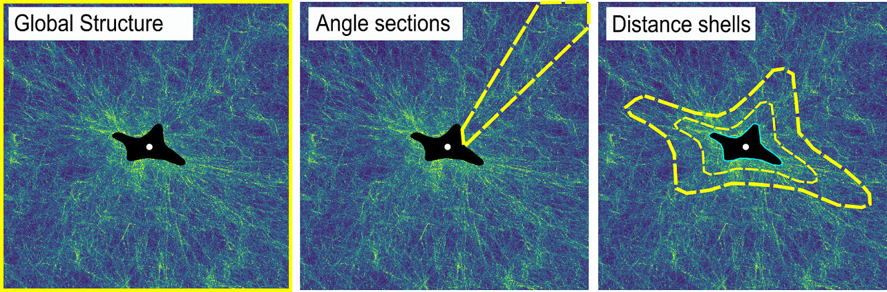</a>

### Combine full-mode results

After running the full analysis with Excel output enabled:

```python
if SaveExcel:
    combined_folder = os.path.join(output_folder, "Combine_Set1")
    SummarizeResultsTotal(data=output_folder, output_folder=combined_folder)
    SummarizeResultsDistance(data=output_folder, output_folder=combined_folder)
```

These functions recursively search for the exact names `results_total.xlsx` and `results_distance.xlsx`. To exclude a result, move it outside the searched directory or rename the relevant file, for example to `_results_total.xlsx`. They need full-mode Excel results; axis-only output contains no such tables. The distance-summary function also saves its own figures, independently of the earlier per-image `plotting` setting.

We receive one combined Excel sheet for the global analysis and another for the mean distance analysis. Within each image, the reported columns distinguish unweighted, coherency-weighted and intensity/coherency-weighted measurements. The combined total mean then gives equal weight to each available **image result**, rather than pooling all pixels. The combined `Overall weighted Oriantation (mean all cells)` column contains the mean of `Orientation (weighted by intensity and coherency)` across image results; its historical spelling is retained. The function does not automatically group images into biological experiments. Distance summaries average corresponding shell rows, so use the same physical shell width across inputs; they do not interpolate different distance grids.

`Mean Angle` in the full tables describes deviation from the cell-center direction. `Orientation` is +1 for radial alignment and -1 for perpendicular alignment. These are different from the signed x/y-axis angles discussed below.

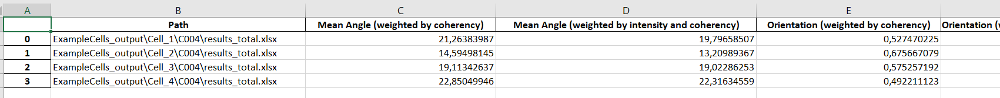

</details>

<a id="save-numpy-files"></a>

<details>
<summary>Save NumPy files: maps, vector components and loading results</summary>

Set `SaveNumpy=True` to save maps for later plotting or analysis. Cropped maps have `2 * edge` fewer pixels along each image dimension. `FiberImageCrop.npy` is a contrast-normalized crop, not the original raw intensity image. `CoherencyMap.npy` describes local anisotropy; undefined regions can contain NaN.

The Python pipeline defaults to an edge crop of 15 pixels; the cell example above uses 40 pixels.

These are NumPy arrays, not rendered figures. Scalar maps have shape `(height - 2*edge, width - 2*edge)` and are indexed as `[row, column]`. Angle and alignment maps can contain NaN where the corresponding quantity is undefined. The mask is a Boolean array on the same cropped grid; `center.npy` stores `(x, y)` in that grid.

The existing full-mode maps include:

| File | Meaning |
|---|---|
| `OrientationMap.npy` | Orientation relative to the cell center, from -1 to +1 |
| `AngleDeviationMap.npy` | Angular deviation from the cell-center direction |
| `OrientationMap_weight_intcoh.npy`, `AngleDeviationMap(weight_int_coh).npy` | Existing intensity/coherency-weighted maps |
| `segmention.npy`, `center.npy` | Cropped cell mask and cell-center coordinates in the cropped image |
| `CoherencyMap.npy`, `FiberImageCrop.npy` | Coherency and normalized fiber-image crop |
| `AngleMap_NoReference.npy` | Compatibility name for the x-axis fiber angle |

<a href="docs/images/npy-files-1.png">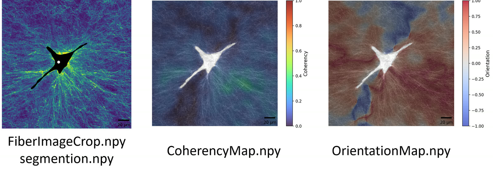</a>
<a href="docs/images/npy-files-2.png">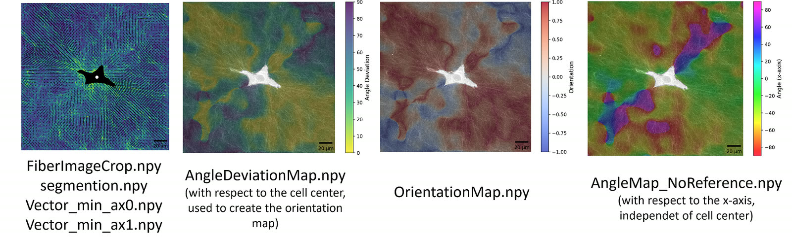</a>

The screenshots show the historical full-mode outputs. Both direction vectors keep their names and components: `Vector_min_ax0.npy` and `Vector_min_ax1.npy` contain the fiber direction; `Vector_max_ax0.npy` and `Vector_max_ax1.npy` contain the perpendicular structure-tensor gradient direction. For both, `ax0` is the x component and `ax1` is the downward y component in image coordinates. The additional x/y angle maps describe the fiber direction only. Separate maximum-eigenvector angle maps are redundant and are not exported. Existing result folders remain readable.

`CoherencyMap.npy` can also be useful when directions vary across an image. For example, stress fibers in different cells may have different mean directions while each cell remains strongly aligned locally. Averaging coherency within the selected cell areas measures this local directional consistency.

```python
import numpy as np

maps_folder = os.path.join(out_list[0], "NumpyArrays")
coherency = np.load(os.path.join(maps_folder, "CoherencyMap.npy"))
angle_x = np.load(os.path.join(maps_folder, "Angles_towards_x_axis.npy"))
cell_mask = np.load(os.path.join(maps_folder, "segmention.npy"))
valid = (~cell_mask) & np.isfinite(coherency)
mean_coherency = float(coherency[valid].mean()) if valid.any() else float("nan")
```

This example reads the first full-mode result above. For masked X/Y results, use `ValidityMask.npy` as the area to include. The full-mode `segmention.npy` instead marks the cell area to exclude from the surrounding-matrix statistics.

Full mode excludes the segmented cell region from the tensor input unless `ignore_cell_outline=True`. With `cell_list=None`, it instead uses a dummy cell to provide a reference center and includes the fiber signal throughout the image. This retains the earlier full workflow; its artificial center is not a measured biological cell center. The original input-list call remains available:

```python
fiber_list, cell_list, out_list = generate_lists(
    fiber_list_string, None, output_main=output_folder)
```

For a new measurement without a cell reference, choose the X/Y mode described next. To choose the reference explicitly, use the point mode below.

<a href="docs/images/npy-files-3.png">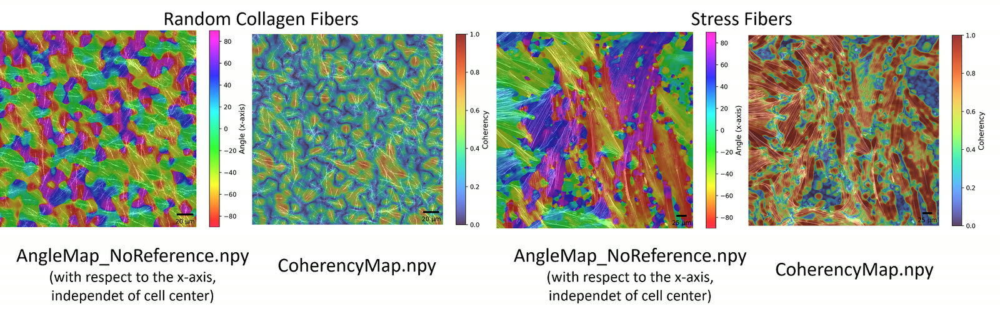</a>

</details>

<a id="orientation-towards-the-xy-axes-without-cell-analysis"></a>

<details>
<summary>X/Y workflow: whole image or optional mask</summary>

For fiber images without a cell reference, use `analysis_mode="axis_orientation_only"` and `cell_list=None`. This skips the dummy cell, segmentation, cell-centered/radial analysis, angular sectors, distance shells and Excel summaries. The fiber filters and tensor calculation are the same as in full mode. `analysis_mode="full"` remains the default for existing calls.

The complete [stress-fiber example](Tutorial/Example_AxisOrientation.py) selects the eight bundled images. For a separate axis-only run from the repository root:

```python
fiber_list_string = os.path.join("Tutorial", "StressFibers", "controlzoom1.5", "Experiment_0*_ch00*.tif")
axis_output_folder = os.path.join("Tutorial", "AxisOrientation_output")
fiber_list, cell_list, out_list = generate_lists(fiber_list_string, None, output_main=axis_output_folder)
scale = 0.48
StuctureAnalysisMain(fiber_list=fiber_list,
                     cell_list=None,
                     out_list=out_list,
                     scale=scale,
                     sigma_tensor=3 / scale,
                     edge=10,
                     sigma_first_blur=0.5,
                     norm1=1, norm2=99,
                     plotting=True,
                     SaveNumpy=True,
                     analysis_mode="axis_orientation_only")
```

`plotting=False` skips figures while `SaveNumpy=True` still saves arrays. `SaveExcel` has no effect in axis-only mode. Do not call the cell-based Excel summaries on these outputs.

[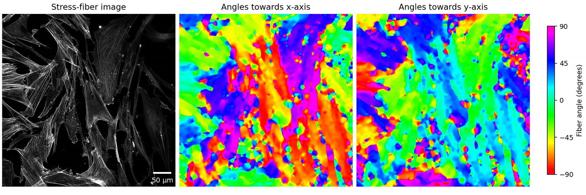](docs/images/axis-orientation-example.png)

*Cropped stress-fiber input and fiber angles towards x and y. These unmasked tensor maps show the same fiber directions using different reference axes.*

Both modes save `Angles_towards_x_axis.npy` and `Angles_towards_y_axis.npy` for the minimum eigenvector (fiber direction), alongside both components of the minimum and maximum vectors. The unmasked reduced output contains eleven NumPy files, a subset of the seventeen full-mode files, including `Alignment_x_axis.npy` and `Alignment_y_axis.npy`. Masked analysis additionally saves `ValidityMask.npy`. The complete list is in [axis_orientation_only.md](docs/axis_orientation_only.md).

The x/y files are **2D matrices of angles in degrees**, not vector components. Values lie in `[-90, 90)`, with NaN for undefined orientation. For x, horizontal fibers are 0°, vertical fibers are -90°, and fibers sloping up to the right are +45°. The y convention is `wrap180(angle_x - 90)`. `AngleMap_NoReference.npy` remains an alias of the x-angle map for existing readers.

With `plotting=True`, `Angles_towards_x_axis.png` and `Angles_towards_y_axis.png` replace the previous no-reference plot. The existing overlay function, colormaps, transparency and scalebar are retained.

```python
from CompactionAnalyzer.plotting import load_axis_arrays, convert_axis_reference

arrays = load_axis_arrays(os.path.join(out_list[0], "NumpyArrays"))
angle_x = arrays["min_x"]
angle_y = arrays["min_y"]
# Only for reproducing an existing reader that used 90 - angle_x:
old_reader_values = convert_axis_reference(angle_x, "legacy_flip")
```

The loader also accepts older `AngleMap_NoReference.npy` files and derives missing y maps. `legacy_flip` is an explicit compatibility convention, not a gradient-to-fiber correction. When averaging directions, account for their axial nature: +89° and -89° are almost parallel even though their arithmetic mean is 0°.

The [actinin-mask example](Tutorial/Example_ActininMask.py) selects actinin-positive pixels from already saved Phall orientation maps to focus on cardiomyocyte-containing areas in a mixed culture. Supply matching channels/results and the original scale/crop; these precomputed maps are not bundled. For a complete example starting from the supplied phalloidin/α-actinin image pair, see [the direct mask analysis above](#mask-from-a-second-image). It saves masked x/y angle arrays, the existing-style overlays and a mask-check image. Inspect the intensity mask before using the selected values; it does not identify individual cell types automatically.

### Axis orientation inside a validity mask

Use `analysis_mode="axis_orientation_masked"` with fiber images in `fiber_list` and mask-source images in `cell_list`. To obtain a mask from the same image (for example, phalloidin-stained cell areas), pass the same image paths in both lists. For a mask from another channel (for example, alpha-actinin-positive areas), pass registered second-channel images in `cell_list`. Neither case defines a radial reference. The [minimal masked example](Tutorial/Example_AxisOrientationMasked.py) analyzes a single matching Phall/actinin pair with relative paths; these paired input images must be supplied separately.

The mask is computed from the **raw mask-source image after edge cropping**: Gaussian smoothing with `mask_sigma=5` pixels, then `filtered > threshold_otsu(filtered * mask_threshold)`. The Python API retains `mask_threshold=0.6`, matching the separate actinin reader. The Saenopy GUI starts at **0.5**; the phalloidin example uses **0.25** to include its faint cell extensions. `mask_invert=True` selects the complement. Adjust blur and threshold to select the cell area, and inspect the mask preview; lower threshold factors include dimmer regions. All selected regions are retained, without the full mode's selection of the object whose centroid is closest to the image center. The tensor is calculated from the unchanged fiber image before applying the validity mask.

Raw angle/vector files retain their existing meanings. Select `arrays["min_x"][arrays["validity_mask"]]` after `load_axis_arrays(...)` to read only masked angles; discard nonfinite values. The saved `Alignment_x_axis.npy` / `Alignment_y_axis.npy` already contain NaN outside the mask. Saved-data overlays automatically honor `ValidityMask.npy`.

In **both axis modes**, `SaveNumpy=True` also writes `results_axis.csv` and `histogram_axis.csv`. Alignment uses the package's linear definition, `1 - abs(angle)/45`: +1 parallel, 0 at 45 degrees, -1 perpendicular. The main mean gives each finite selected pixel equal weight; coherency and intensity/coherency weighted means are separate columns. x and y alignment are opposites. The two signed angle histograms use 36 fixed bins from -90 to 90 degrees and the same valid pixel set. An empty selection yields zero histogram counts and NaN means.

With `plotting=True`, both axis modes save `Histogram_axis_orientation.png`. Masked mode also saves a mask check and two side-by-side channel plots, one per reference axis, with `gist_rainbow` and 25% angle overlay. Existing single-image overlays keep their previous style. `plotting=False` skips every figure; `SaveNumpy=False` skips NumPy and CSV files. Neither axis mode runs cell-distance/sector statistics or Excel exports. Do not pool z slices with their own MAX projection as independent observations.

</details>

## API: Analyze an image with a single call

Use `analyze_image` to return a number or a map directly to your Python code.
Run this from the repository root to get the mean cell-relative alignment
for the same image pair, without saving files:

```python
from CompactionAnalyzer import analyze_image

alignment = analyze_image(
    "Tutorial/ExampleCells/Cell_1/C003.tif",  # Collagen
    "Tutorial/ExampleCells/Cell_1/C004.tif",  # Cell stain
    mode="full", outputs="mean_alignment_cell",
    scale=0.318, sigma_tensor=7 / 0.318, edge=40,
    seg_gaus1=6, seg_gaus2=80,
)
print(alignment)  # Approximately 0.395
```

<details>
<summary>API inputs, modes and setup for the examples</summary>

To use the analysis in your own Python code, call `analyze_image` with an image
and the results you want. It returns numbers or maps directly, without saving files.
A single output name returns that value; a list returns a dictionary.
You can pass image paths or NumPy arrays.

The default is `mode="axis_orientation_only"`: X/Y orientation across the image.
For cell-relative analysis, use `mode="full"` and supply the cell image as the
second input. The mode is explicit; adding a second image does not change it.
All [available modes](docs/direct_api.md#choose-the-measurement) are listed in the API reference.

The following examples use bundled images or generate synthetic fields. From the
repository root, install the package with `python -m pip install -e .`,
then run this setup once before trying the snippets:

```python
from pathlib import Path
from CompactionAnalyzer import analyze_image

data = Path("Tutorial")
```

Returned maps are edge-cropped and contain NaN where the quantity is undefined
or outside the selected region. Mean X/Y and line angles use axial circular
statistics; mean deviations average absolute angles. The API reuses the existing
tensor and segmentation calculations without file exports. Point mode also supports
[distance-shell profiles](#distance-shells-around-a-point); cell-distance shells and
angular sectors remain part of the full batch workflow.

Try all five analysis modes with `python Tutorial/Example_Quickstart.py`.
To reproduce the collagen figure, add `--figure collagen-example.png`.
The script resolves its input paths relative to the repository. See the
[API reference](docs/direct_api.md) for all modes, outputs and parameters,
or the earlier [direct-API example](Tutorial/Example_DirectAPI.py).
Point and line modes are available in `analyze_image` and the GUI;
`StuctureAnalysisMain` provides the full cell workflow and the two X/Y modes.

</details>

<details>
<summary>Cell-relative alignment: collagen</summary>

### Cell-relative alignment: collagen

Start with one of the original collagen examples. `C003.tif` shows the fibers;
`C004.tif` shows the calcein-stained cell. The cell image supplies the segmentation
and reference center. This call returns two numbers, the alignment map and the cell mask:

```python
cell = analyze_image(
    data / "ExampleCells/Cell_1/C003.tif",  # Collagen
    data / "ExampleCells/Cell_1/C004.tif",  # Cell stain
    mode="full",
    outputs=["mean_alignment_cell", "mean_angle_cell",
             "alignment_cell", "cell_mask"],
    scale=0.318, sigma_tensor=7 / 0.318, edge=40,
    seg_gaus1=6, seg_gaus2=80,
)
print(cell["mean_alignment_cell"], cell["mean_angle_cell"])
```

For this image and these settings, the mean alignment is about **0.395** and the
mean angular deviation is **27.2°**. Alignment is +1 radial, 0 at 45° and −1 tangential.

[](docs/images/collagen-api-quickstart.png)

*Left: collagen. Middle: cell stain with the returned segmentation in red.
Right: collagen with the cell-relative alignment map. All three panels show the
same 40-pixel crop; the segmented cell is excluded from the alignment statistics.*

<details>
<summary>Try all four collagen/cell pairs</summary>

Each folder contains its matching collagen and cell image. This loop returns one number per cell:

```python
cell_list = sorted((data / "ExampleCells").glob("Cell_*"))
for folder in cell_list:
    alignment = analyze_image(
        folder / "C003.tif", folder / "C004.tif", mode="full",
        outputs="mean_alignment_cell",
        scale=0.318, sigma_tensor=7 / 0.318, edge=40,
        seg_gaus1=6, seg_gaus2=80,
    )
    print(folder.name, alignment)
```

</details>

</details>

<details>
<summary>Whole-image orientation</summary>

### Whole-image orientation

Measure the mean alignment, mean angular deviation and angle map in the random
collagen field:

```python
collagen = next((data / "EmptyGel/Pos01").glob("*C003*.tif"))
unmasked = analyze_image(
    collagen, mode="axis_orientation_only",
    outputs=["mean_alignment_x", "mean_deviation_x", "angle_x"],
    scale=0.249, sigma_tensor=7 / 0.249, edge=128, sigma_first_blur=0.5,
)
print(unmasked["mean_alignment_x"], unmasked["mean_deviation_x"])
# Approximately -0.080 and 48.6 degrees in this field.
# Uniformly distributed orientations give 0 and 45 degrees in the mean.
```

The same outputs are available for Y. Use `outputs="mean_deviation_x"` to return
just one number instead of a dictionary.

</details>

<details>
<summary>Orientation inside a mask</summary>

### Orientation inside a mask

Here the phalloidin image provides both the stress-fiber signal and the mask of
the stained cell area. Angles, coherency and averages include only selected pixels:

```python
actin = sorted((data / "StressFibers/controlzoom1.5").glob("*.tif"))[0]
masked = analyze_image(
    actin, mode="axis_orientation_masked",
    outputs=["angle_x", "coherency", "mean_alignment_x", "mean_coherency"],
    scale=0.48, sigma_tensor=3 / 0.48, edge=10, mask_threshold=0.25,
)
print(masked["mean_alignment_x"], masked["mean_coherency"])
# For a separate mask image, add: mask_image="mask_channel.tif"
```

The commented option uses a registered second image to define the mask.
An existing boolean selection can instead be passed as `mask=selected_area`.
The [cardiomyocyte example](#mask-from-a-second-image) uses the bundled cardiomyocyte image pair with α-actinin as `mask_image`.

</details>

<details>
<summary>Orientation towards a point</summary>

### Orientation towards a point

Use the synthetic fiber field and its annular mask:

```python
from Tutorial.Example_SyntheticReferences import make_image

image, selected_area, reference = make_image("point")
point = analyze_image(
    image, mode="point_orientation", reference_point=reference,
    mask=selected_area,
    outputs=["mean_alignment_point", "mean_angle_point"],
    sigma_tensor=5, edge=15,
)
print(point)  # Local directions vary around a preferred deviation of 25 degrees.
```

Coordinates are zero-based pixels of the original, uncropped image: `(0, 0)`
is top left, X increases rightwards and Y downwards. Point-relative alignment
is +1 radial and −1 tangential. The reference pixel itself has no radial direction.

</details>

<details>
<summary>Orientation relative to a line</summary>

### Orientation relative to a line

Use the synthetic fiber image, its elliptical mask and two reference points:

```python
from Tutorial.Example_SyntheticReferences import make_image

image, selected_area, reference = make_image("line")
line = analyze_image(
    image, mode="line_orientation", reference_line=reference,
    mask=selected_area,
    outputs=["mean_alignment_line", "mean_deviation_line", "angle_line"],
    sigma_tensor=5, edge=15,
)
print(line["mean_alignment_line"], line["mean_deviation_line"])
# line["angle_line"] is the signed angle map in degrees.
```

Both points must be inside the image; fractional pixel coordinates are accepted.
The line applies across the whole image, independent of segment length or endpoint order.
`angle_line` is signed in `[-90, 90)` degrees. `mean_deviation_line` averages its
absolute value, from 0° parallel to 90° perpendicular. `mean_alignment_line` is
+1 parallel and −1 perpendicular. Use `outputs="alignment_line"` to return that map directly.

For either reference mode, omit `mask` to analyze the whole image. Use
`mask_image="mask_channel.tif"` instead to create a mask from a second image;
passing the orientation image again creates a same-image mask. The mask selects
pixels after the tensor calculation and does not move the reference.

</details>

## Citation

If you use CompactionAnalyzer in your work, please cite:

*Böhringer D, Bauer A, Moravec I, Bischof L, Kah D, Mark C, Grundy TJ, Görlach E, O'Neill GM, Budday S, Strissel PL, Strick R, Malandrino A, Gerum R, Mak M, Rausch M, Fabry B*. **Fiber alignment in 3D collagen networks as a biophysical marker for cell contractility**. Matrix Biology **124**, 39–48 (2023). [doi: 10.1016/j.matbio.2023.11.004](https://doi.org/10.1016/j.matbio.2023.11.004)

CompactionAnalyzer is distributed under the [GNU General Public License v3.0](LICENSE).
